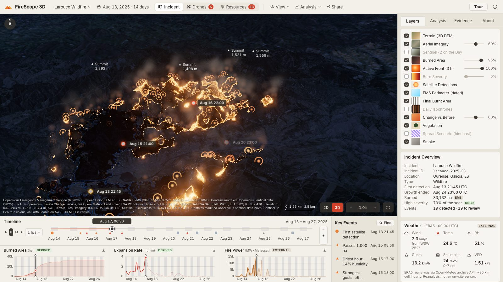
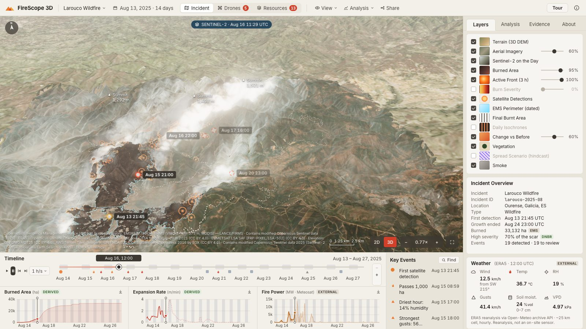
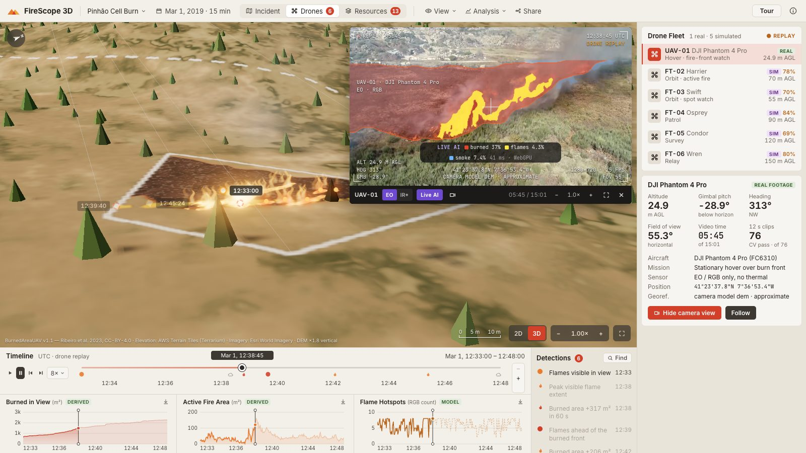

# FireScope 3D

**Drone and satellite imagery of a wildfire, on one 3D map and one clock.**

🌐 **Live:** https://aleetreny.github.io/FireScope-3D/ · 📐 [Methods and sources](https://aleetreny.github.io/FireScope-3D/methods.html) · runs entirely in your browser: no server, no keys, no account.



FireScope 3D turns the scattered evidence of a fire into something you can scrub through:
- **Where and when it burned**, hour by hour, on real terrain.
- **What the cameras and satellites saw** on each pass, searchable by what is in the pixels.
- **Charts, weather and key events**, all on the same clock as the map.
- **An analyst you can question** in English or Spanish, that cites the moment behind every answer.

Every number carries its provenance (real, derived, external, model or simulated), and the [methods page](https://aleetreny.github.io/FireScope-3D/methods.html) says how each one was produced and checked.

> Exploratory decision-support prototype. **Not** a certified emergency-management or fire-spread prediction system.

## Two incidents

| | Larouco wildfire (default) | Pinhão drone burn |
|---|---|---|
| **What** | Ourense, Spain, 13–27 Aug 2025: **33,132 ha** in 14 days, 42 × 41 km of terrain | Torre do Pinhão, Portugal, 1 Mar 2019: a prescribed burn, 15 min from a hovering drone |
| **Rebuilt from** | NASA FIRMS detections + 12 dated Copernicus EMS perimeters + Meteosat every 15 min; Sentinel-2 severity and true colour; ERA5 weather | BurnedAreaUAV drone video, camera pose and hand-drawn masks |
| **Checked against** | Each EMS perimeter held out and predicted from the rest: **IoU 0.78 / 0.85 / 0.94** | Hand-drawn masks the model never trained on: **IoU 0.92** in the image, **0.90** on the ground |
| **Also** | Sentinel-2 image of each pass draped by date · burn severity · daily fronts · a spread hindcast scored against reality (IoU 0.25, shown as what it is) | Video synced to the map · rate of spread · live analysis of the video in the browser |

Switch with the incident menu or `?incident=pinhao-2019-03-01`. The **Tour** button walks through each incident (16 and 20 chapters), and each tour ends by offering the other.

<table><tr>
<td></td>
<td></td>
</tr><tr>
<td>Larouco on 16 Aug at 11:29 UTC: the Sentinel-2 image of that pass, plume and pyrocumulus included, on the reconstructed scar.</td>
<td>Pinhão: the drone video with <b>Live AI</b>, the burned-area model running in the browser at ~40 fps.</td>
</tr></table>

## What you can do

- **Scrub through time.** The timeline is the single clock for the map, charts, events, video and panels. Zoom into any hour (wheel, pinch or the −/+ buttons), with nights shaded and the real sun and night on the terrain.
- **Read the evidence.** Each layer can be turned off and names its source: the arrival-time front, burn severity, daily isochrones, dated EMS perimeters, FIRMS detections, Sentinel-2 on the day, vegetation that chars, smoke that leans with the hourly wind.
- **Ask.** "When did it grow fastest?", "¿Cuántas hectáreas se quemaron?". The analyst is rule-based: it answers from the data in the browser and cites the moments it used. No language model, nothing generated.
- **Search.** Use keywords over the events and measurements. Optional **visual search** (≈50 MB once) searches what Sentinel-2 or the drone camera saw: "smoke plume", "burn scar", "humo denso". It says "no clear match" when something is not there.
- **Analyse a video.** Live AI runs on the Pinhão footage, or on a video file of your own, which is never uploaded.
- **Rehearse the response.** A simulated fleet (aircraft, drones, crews) works the real front, and every part of it is tagged SIM.
- **Share the view.** A link opens the same instant, camera and panel. It works on phones and tablets (bottom sheet, drawer) and offline after the first visit.

## How it works

```
 OFFLINE, once per incident (Python)                         STATIC SITE (GitHub Pages)
 pipeline/larouco/   FIRMS · EMS · Meteosat · Sentinel-2 ·   incidents/<id>/  incident · timeline · events ·
                     ERA5 · MDT25/PNOA → arrival-time field   ───────────────▶  observations · weather · eval ·
                     severity · scenario · basemap · passes   export-static     manifest (methods) · basemap ·
 pipeline/pinhao/    video → learned masks → camera + DEM     (npm run build)   Sentinel-2 · visual index · video
                     → polygons · events · eval · frames                        models/  (segmenter, MobileCLIP text)
                                                                                     │
 frontend/  React 19 · TypeScript · Vite · Three.js (custom terrain, fire and sun shaders) · Zustand
            analyst + search (src/agent) · in-browser models (src/ai, ONNX Runtime Web) · simulated ops (src/sim)
```

The full method, the validation tables and every source with its licence are on the [methods page](https://aleetreny.github.io/FireScope-3D/methods.html) (source: [`frontend/methods.html`](frontend/methods.html)). The pipelines are documented in [`pipeline/larouco/README.md`](pipeline/larouco/README.md) and [`pipeline/pinhao/README.md`](pipeline/pinhao/README.md).

## Run it

```bash
cd frontend
npm install
npm run dev      # http://localhost:5173, the two packaged incidents
npm run build    # → dist/, what GitHub Pages serves (relative paths, works under any sub-path)
```

`npm run dev` and `npm run build` first run `scripts/export-static.mjs`. It publishes `data/processed/` and `media/` as incident packages, and fetches MobileCLIP's text encoder at a pinned revision, checking its hashes.

## Rebuild the data

Python 3.13 and `pip install -r pipeline/requirements.txt`, from the repository root:

```bash
# Larouco: open data, no accounts (Meteosat needs a free EUMETSAT LSA SAF account and is optional)
python -m pipeline.larouco.download && python -m pipeline.larouco.progression && python -m pipeline.larouco.severity
python -m pipeline.larouco.scenario && python -m pipeline.larouco.basemap && python -m pipeline.larouco.s2series
python -m pipeline.larouco.package

# Pinhão: BurnedAreaUAV from Zenodo 7944963 (≈1 GB, CC BY 4.0), unpacked in data/raw/burnedareauav/
python -m pipeline.pinhao.segmenter train      # fine-tune and evaluate the burned-area segmenter (~7 min on a laptop GPU)
python -m pipeline.pinhao.replay               # masks → ground → timeline, events, eval
python -m pipeline.pinhao.frames               # frames for visual search

cd frontend && node scripts/ai/embed.mjs       # image vectors for visual search
```

## Tests

```bash
python -m pytest pipeline/tests -q                                         # pipelines and packages
cd frontend
node scripts/e2e.mjs 'http://localhost:4173/?incident=pinhao-2019-03-01&nointro'   # 87 functional checks
URL='http://localhost:4173/?nointro' node scripts/present-test.mjs out             # the tour (either incident)
node scripts/audit/devices.mjs '<url>' out                                 # 8 phones and tablets: overlaps, clipping
node scripts/audit/states.mjs '<url>' out                                  # 11 states × 5 desktop sizes
node scripts/audit/ai.mjs && node scripts/audit/live.mjs                   # visual search · live analysis vs the pipeline
node --experimental-strip-types scripts/ai/calibrate.mjs                   # visual-search match strength
```

The audit scripts are described in [`frontend/scripts/audit/README.md`](frontend/scripts/audit/README.md). Every push to `main` runs the pipeline tests and deploys the site ([`.github/workflows/`](.github/workflows/)).

## Limits

- **Larouco:**
  - Timing between satellite passes (about six a day) is interpolated, and the first detection is not the ignition.
  - The method was tuned on the same perimeters it is scored against, so its IoU is slightly optimistic.
  - There is no data on people or houses.
- **Pinhão:**
  - The camera is RGB only, so there are no temperatures.
  - Positions are approximate, and their error in metres could not be measured with this footage.
  - The segmenter was trained on this one flight.
- **Both:** the fleet, the extra drones and the Pinhão large-fire scenario are simulated.

The [methods page](https://aleetreny.github.io/FireScope-3D/methods.html#larouco) lists the limits in full.

## History

FireScope 3D was built in a day at the **VAST Builders Challenge (17 Oct 2026)**, on NVIDIA Cosmos models running on the event's cluster ([docs/historia-hackathon.md](docs/historia-hackathon.md)). This public version needs none of that:
- everything is recomputed from open data;
- it runs as a static site;
- its AI runs in the visitor's browser.

How the hackathon prototype was audited and turned into this is in [docs/PLAN_DE_MEJORA.md](docs/PLAN_DE_MEJORA.md) (Spanish); the pitch is in [docs/PITCH_Y_FUNCIONAMIENTO.md](docs/PITCH_Y_FUNCIONAMIENTO.md).

## Credits and licence

**Code:** MIT ([LICENSE](LICENSE)).

**Data and models keep their own licences:**
- BurnedAreaUAV, Ribeiro et al. 2023 (CC BY 4.0)
- Copernicus Emergency Management Service (© 2025 European Union), EMSR837
- NASA FIRMS (LANCE)
- Contains modified Copernicus Sentinel data (2025)
- EUMETSAT LSA SAF FRP-PIXEL
- ERA5 (Copernicus C3S) via Open-Meteo
- IGN/CNIG MDT25 and PNOA (CC BY 4.0)
- ESA WorldCover (CC BY 4.0)
- Sentinel-2 cloudless 2016 by EOX (CC BY 4.0)
- AWS Terrain Tiles
- Esri World Imagery
- MobileCLIP-S0 (Apple)
- LR-ASPP MobileNetV3 (torchvision)

**Interface:** inspired by the FireTrace prototype by Dilum Sanjaya; the implementation is independent.
